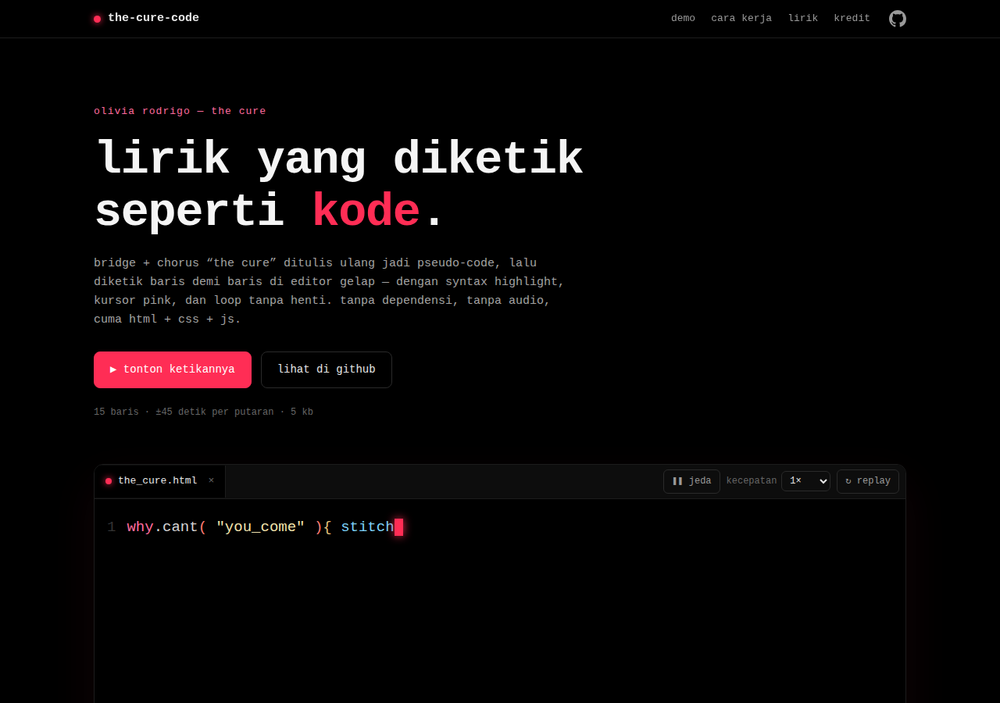
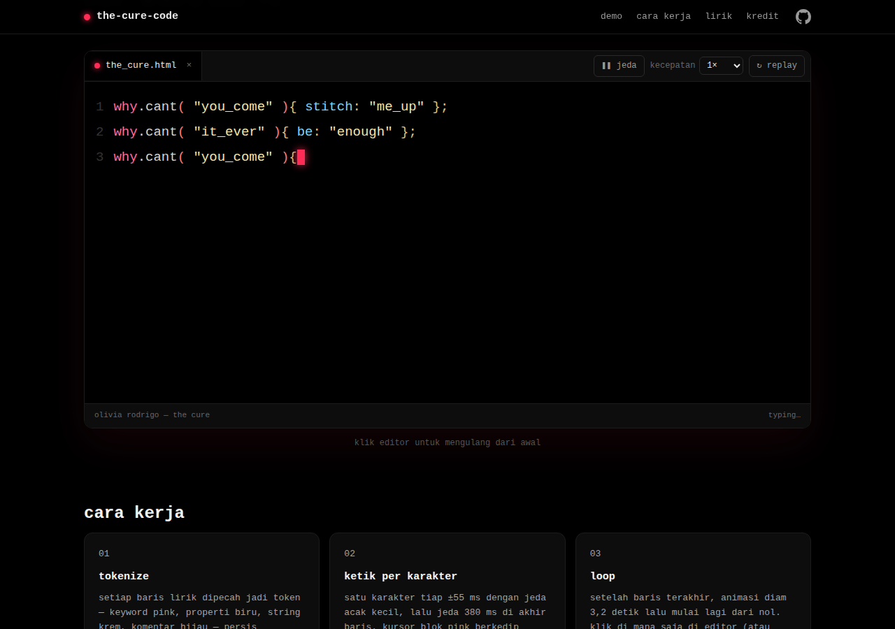
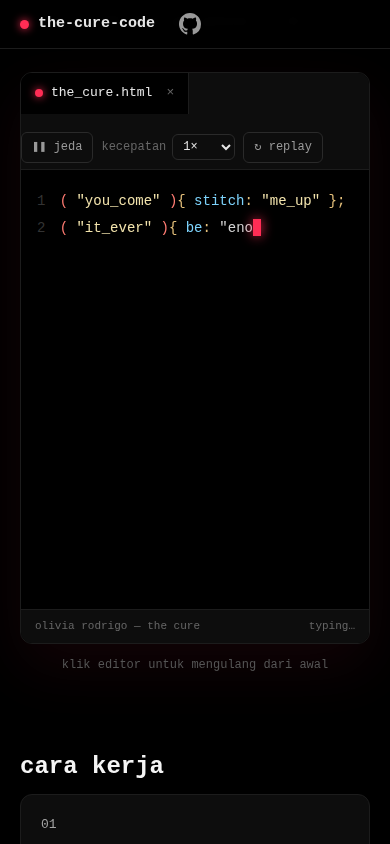

# the-cure-code

**the cure** — olivia rodrigo, lyrics typed as code.

[](https://github.com/dezzorigin/the-cure-code/actions/workflows/ci.yml)
[](LICENSE)

bridge + chorus "the cure" ditulis ulang jadi pseudo-code, lalu diketik baris
demi baris di editor gelap — syntax highlight, kursor blok pink, loop tanpa
henti. tanpa dependensi, tanpa audio, cuma html + css + js.

**live:** https://the-cure-code.pages.dev



## demo video

[](docs/demo.mp4)

> video direkam headless dari situs live, **tanpa suara** — produk ini memang
> tidak punya audio sama sekali. klik gambar di atas untuk memutar mp4-nya.

## jalankan

buka `index.html` langsung di browser, atau serve statis:

```bash
python3 -m http.server
```

lalu buka http://localhost:8000 — animasi langsung jalan.

## yang bisa dilakukan

- **tonton** — animasi mulai otomatis, 15 baris, ±45 detik per putaran, lalu
  loop sendiri.
- **jeda / lanjut** — tombol di tabbar editor membekukan ketikan dan
  meneruskannya dari posisi yang sama.
- **kecepatan** — 0.5× / 1× / 2×, berlaku untuk ritme ketik dan semua jeda.
- **replay** — tombol replay, atau klik di mana saja di editor.

## cara kerja

1. **tokenize** — tiap baris dipecah jadi token (keyword pink, properti biru,
   string krem, komentar hijau) persis pewarnaan di video aslinya.
2. **ketik per karakter** — satu karakter tiap ±55 ms, jeda 380 ms di akhir
   baris, kursor blok pink berkedip mengikuti.
3. **loop** — setelah baris terakhir, diam 3,2 detik lalu mulai lagi dari nol.

detail lengkap: [docs/PRD.md](docs/PRD.md) · [docs/ARCHITECTURE.md](docs/ARCHITECTURE.md) ·
[docs/CHANGELOG.md](docs/CHANGELOG.md) · [diagram alur](docs/diagram.svg)

## lirik — sebagai kode

```
why.cant( "you_come" ){ stitch: "me_up" };
why.cant( "it_ever" ){ be: "enough" };
// by nabil
{ its_not: "enough" };
oh.because( "my_head" ){ is_full_of: "poison" };
and( "my_heart" ){ is_full_of: "doubt" };
i.got( "toxins" ){ in: "my_bloodstream" };
you.tried_so_hard( to: "suck_em_out" ) };
and( "it_feels" ){ like: "medication" };
and( "its_good" ){ for_me: "im_sure" };
but.it( "it_dont_matter" ){ how: "your_love_feels_anymore" };
itll_never_be( "the_cure" );
```

satu perbaikan dari versi awal: baris ke-10 kurungnya tidak tertutup di
transkrip asli (`... "suck_em_out" };`) — sudah ditutup di sini, dicatat di
[changelog](docs/CHANGELOG.md).

## screenshot

| landing | editor saat mengetik | mobile |
|---|---|---|
|  |  |  |

## kredit

- format terinspirasi [@idfcauuu](https://www.tiktok.com/@idfcauuu/video/7706215484160625926)
  di tiktok.
- lagu: "the cure" — olivia rodrigo, dari album *you seem pretty sad for a
  girl so in love* (2026). tidak ada audio di repo ini.
- lisensi: [MIT](LICENSE)
